# LOOPHEADS operator manual

For **LOOPHEADS 0.1.2** on the **M‑VAVE FM‑1**.

The battery icon in the upper-right corner of each menu shows the FM‑1’s
approximate charge level. More bars indicate a higher charge.

## Play in a browser

Download [loopheads_0.1.2.fwsc](https://github.com/jaak-stjaaques/LOOPHEADS-public/releases/download/v0.1.2/loopheads_0.1.2.fwsc).
Open the [FM‑1 emulator](https://joakimeriksson.github.io/fm1-emu/?fw=local&mhz=100),
choose **Open .fwsc…** and select the downloaded file, then press **Start**.

## Make your first loop

1. Turn up **MASTER** and play a few keys. **OCT−** and **OCT+** shift the keyboard by octaves.
2. Press **SEQ**. Turn **SELECT** to choose a tape. The cyan box shows the selected tape.
3. Press **REC**, then play a phrase. Recording starts immediately and all four tapes start running, each with its own loop length.
4. Press **REC** or **PLAY** to finish recording. The loops keep playing. Press **REC** again to overdub, or turn **SELECT** to choose another tape and record into it.
5. Tap **SAVE** to keep the setup. Press **PLAY** outside a recording take to stop all four tapes. Press it again to restart them from the beginning.

The selected tape is the destination for live playing and recording. **EDIT**,
**ENV**, and **LFO** change its sound. The other three tapes keep their own sounds.

## HOME mixer

  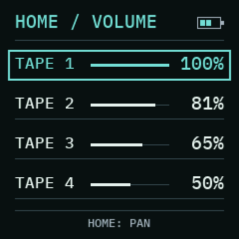
  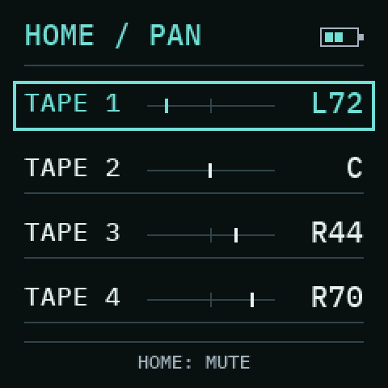
  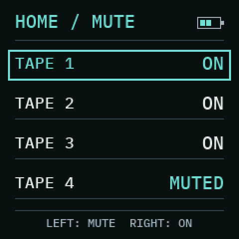

**HOME** opens the last mixer page you used, starting on **Volume** at power-on.
Press **HOME** again to cycle through **Volume → Pan → Mute → Volume**. The cyan
box marks the selected tape. Knobs **1–4** always correspond to tapes **1–4**.

| Page | How to use it |
| --- | --- |
| **Volume** | Set the tape's output level from 0 to 100%. This changes how loud the tape sounds and preserves the velocity of its recorded notes. |
| **Pan** | Place the tape in stereo. `L100` is fully left, `C` is centered, and `R100` is fully right. |
| **Mute** | Turn left to mute or right to unmute. The tape keeps its place. Delay and reverb already ringing can fade naturally. |

## EDIT, ENV, and LFO

  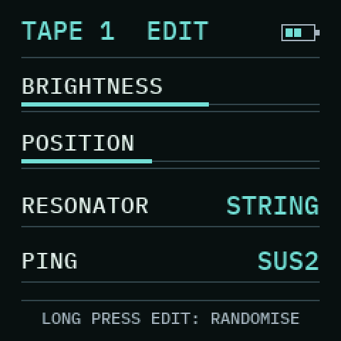
  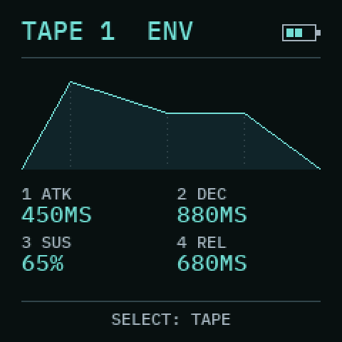
  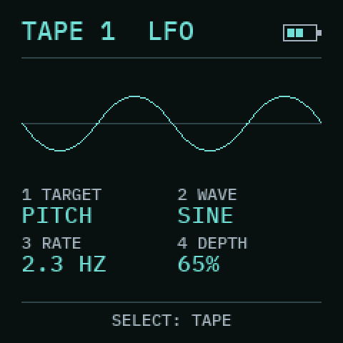

Turn **SELECT** to choose the tape before editing. Its number appears in the
menu title.

| Knob | EDIT | ENV | LFO |
| --- | --- | --- | --- |
| **1** | **Brightness** sets how bright or dark the sound is. | **ATK** sets how quickly the sound rises. | **Target** selects Pitch, Volume, Brightness, or Position. |
| **2** | **Position** shifts where the ping excites the resonator, changing the harmonics. | **DEC** sets how long the sound takes to settle to the sustain level. | **Wave** selects sine, triangle, square, saw, or sample and hold. |
| **3** | **Resonator** selects String, Tube, or Blow. | **SUS** sets the level while a note is held. | **Rate** sets the speed, from 0.1 to 12 Hz. |
| **4** | **Ping** selects what starts the vibration. | **REL** sets how long the sound fades after release. | **Depth** sets the amount. At 0%, modulation is off. |

- **String** sounds plucked, **Tube** sounds hollow, and **Blow** adds breath-driven sustain. The ping choices are white, pink, or brown noise, followed by Sine, Triangle, Saw, Square, Major, Minor, Sus2, and Sus4.
- **Major**, **Minor**, **Sus2**, and **Sus4** each play a three-tone chord rooted at the sounding note using one resonator voice. Use Knob 4 to select the chord shape.
- **Attack**, **Decay**, and **Release** run from 0 to 1500 ms. **Sustain** runs from 0 to 100%. The ENV graph shows the shape used for new notes. The resonator can also fade on its own while a key is held.
- The LFO graph shows the waveform and depth. For **Position**, each new note uses the LFO value at the moment it starts.
- At power-on, all four tapes get independently randomised **EDIT**, **ENV**, and **LFO** settings. Hold **SAVE** to recall a saved sound setup.
- While already on **EDIT**, hold **EDIT** for more than one second to randomise the selected tape's EDIT, ENV, and LFO settings once.

## SEQ Tape Loops and Memory Leak

**SEQ** opens the last SEQ page you used, starting on **TAPE LOOPS** at power-on.
Press **SEQ** again to switch between **TAPE LOOPS** and **Memory Leak**.

### Tape Loops

  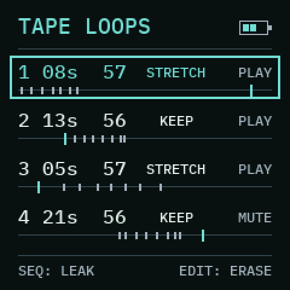

Each row shows the tape number, length, remaining note slots, timing mode, and
transport state. A muted tape shows **MUTE** when playing or stopped. The active
recording tape shows **REC**. The small marks show recorded note starts. The
moving line is the playhead. Each tape holds **64 notes**. Default lengths are
**8, 13, 5, and 21 seconds**. Each loop runs on its own length in seconds, independently of
MIDI clock.

| Control | Action |
| --- | --- |
| **Knobs 1–4** | Set the four tape lengths from **1 to 30 seconds**. |
| **SELECT** | Pick the tape. If you switch tapes while recording, the current take ends. |
| **ALGORITHM left** | **KEEP** leaves note times where they were recorded. Shortening a loop hides notes outside its new length. Lengthen it to bring them back. |
| **ALGORITHM right** | **STRETCH** scales note positions and durations to fit the new loop length. |

Finish recording on a tape before changing its length or timing mode.

**Erase under the playhead.** During playback on the timeline, hold **EDIT** for
about **300 ms** while the selected tape is out of record mode. The erase head
removes note starts that the playhead crosses while you hold the button.
Release **EDIT** to stop erasing. A short press opens the EDIT menu.

### Memory Leak

  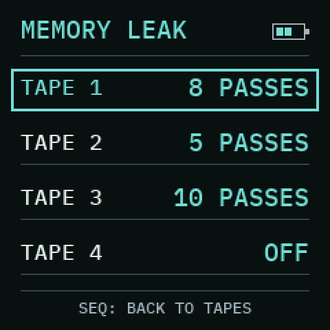

The cyan box marks the selected tape.
Knobs **1–4** set each tape to **OFF, 10, 9, 8, 7, 6, 5, 4, 3, or 2** passes.
Each note gets its own lifetime starting when you record it. Notes added
later in an overdub last for their own passes. A note fades as it returns on
successive passes, then frees its slot. **OFF** freezes the current fade.
Notes hidden outside a shortened **KEEP** loop stay stored.

## SCALE and live transpose

  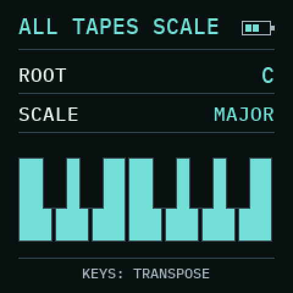

Press **SCALE** to open **ALL TAPES SCALE**. **Knob 1** sets the root. **Knob 2**
picks the scale for all four tapes. The
keyboard graphic shows the notes in that scale. **Chromatic** plays every note.
Other scales move notes to the nearest pitch in the scale. The engine keeps
the original recorded notes, so you can change scales after recording.

While the tapes are playing, hold a key on the **SCALE** page to move all playing
tapes to that root. For example, hold **A** with the root set to **C** to hear
the selected scale on **A**. The last key held takes priority. Release the
transpose keys to return to the root set by Knob 1. Transpose is disabled
while any tape is recording.

## ARP and Strum

  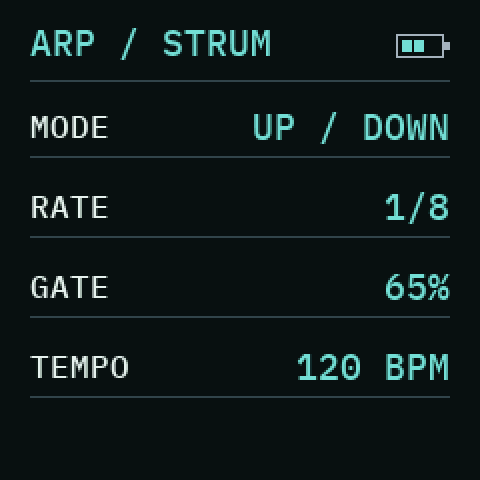
  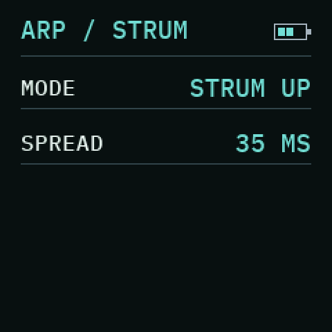

Press **ARP**. Knob **1** selects **Off**, **Up**, **Down**, **Up/Down**,
**Random**, **Strum Up**, or **Strum Down**.

- **Up**, **Down**, and **Up/Down** repeat a held chord in the selected order. **Random** picks a held note on each step and can repeat a note. Knobs **2–4** set the note division (**1/2** through **1/32**), gate length, and internal tempo.
- **Strum Up** and **Strum Down** sweep a held chord once. Knob **2** sets the time between notes, from **5 to 80 ms**.
- Play from the keyboard or send MIDI notes in. Record into a tape to capture the resulting notes. In **GLO / AUTO**, incoming MIDI clock drives the repeating arp when it is available.

## FX Delay and Hall

  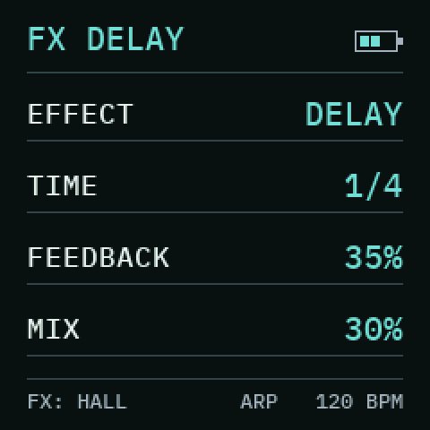
  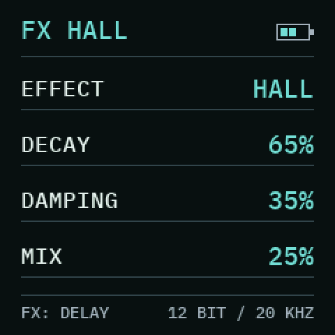

**FX** opens the last effect page you used, starting on **Delay** at power-on.
Press **FX** again to switch between **Delay** and **Hall**. Both effects process
the dry tape mix in parallel at **12-bit, 20 kHz**. The output combines one dry
signal with the Delay and stereo Hall returns. At 100% on both MIX controls,
the two returns are heard at equal levels.

| Knob | Delay | Hall |
| --- | --- | --- |
| **1** | Effect on/off | Effect on/off |
| **2** | Echo division | Reverb decay |
| **3** | Feedback, 0–85% | Damping, which softens the high end of the tail |
| **4** | Dry/wet mix | Dry/wet mix |

Delay follows the MIDI clock source chosen in **GLO**, with the tempo from
**ARP** as its internal tempo. Hall has a stereo tail.

## SAVE and recall

- **Tap SAVE** from any page to capture or replace the single snapshot. After a successful capture, the footer shows **SNAPSHOT** for 500 ms and the SAVE light flashes.
- **Hold SAVE for 300 ms** to recall. After a successful recall, the footer shows **RECALL** for 500 ms and the SAVE light stops flashing. Running tapes keep moving. If a recalled tape is shorter, its playhead wraps to fit the new length. If playback was stopped, press **PLAY** when you're ready.
- The snapshot includes all four tapes, their notes and Memory Leak fades, mixer and synth settings, the selected tape, octave, scale, ARP, and both effects. Recalling replaces the current take and loop contents. Finish recording before recalling if you want to keep the take.
- Unsaved recordings disappear at power-off. After power-on, hold **SAVE** to load a saved snapshot.

## GLO setup

  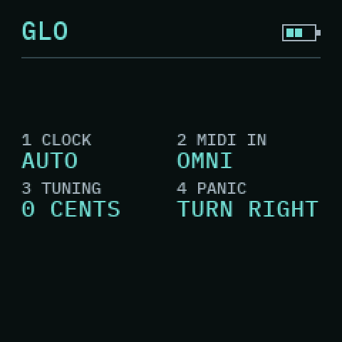

| Knob | Control |
| --- | --- |
| **1 CLOCK** | Turn left for **AUTO** to follow incoming MIDI clock when available. Turn right for **INTERNAL** to use the ARP tempo even when a MIDI clock is present. |
| **2 MIDI IN** | Select **OMNI** for all MIDI input channels, or choose **CH 01–16**. The **PRESETS** encoder also adjusts this setting. |
| **3 TUNING** | Fine-tune the synth from **−50 to +50 cents**. |
| **4 PANIC** | Turn right to release live and arpeggiated notes. The recorded tapes keep playing. |

Clock, MIDI channel, and tuning save separately when the instrument is idle.
Stop the tapes and let the sound fade for a few seconds before switching off
after a GLO change. A SAVE recall keeps your GLO settings.

## If you get stuck

- **A tape advances but is silent.** Check its **HOME / Mute** and **HOME / Volume**, and check **MASTER**.
- **KEYS: TRANSPOSE changes to RECORDING.** Finish the take with **REC** or **PLAY** before transposing from **SCALE**.
- **SAVE fails or recall shows NO SNAPSHOT.** A snapshot must save successfully before it can be recalled.
- **The FM‑1 fails to start after installation.** See the [build and recovery notes](BUILDING.md).
